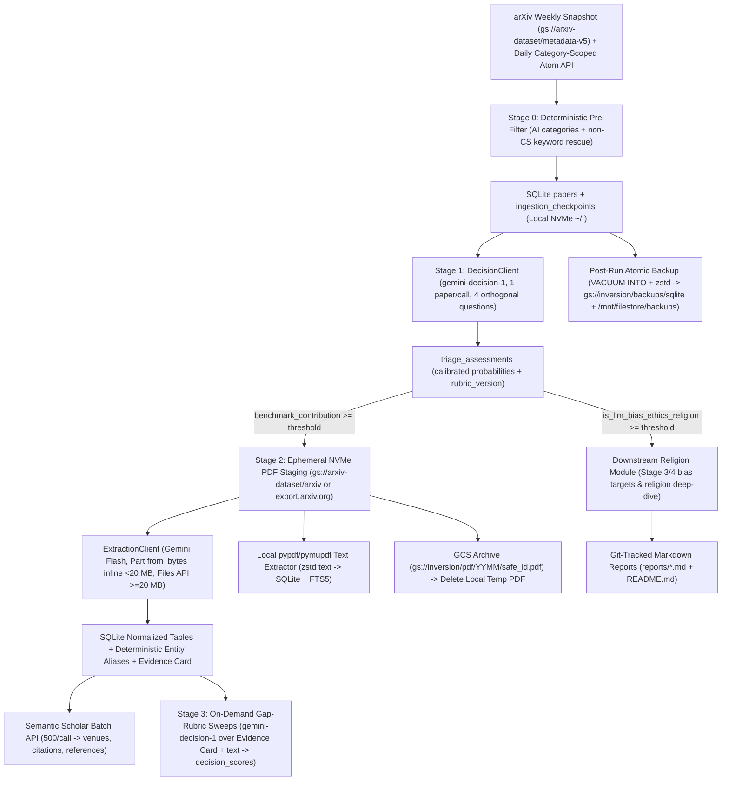

# All-ArXiv AI Benchmark Corpus Expansion & Gemini Decision 1 Pipeline

*   **Author:** Walter Reade
*   **Status:** Approved
*   **Date:** 2026-11-13

--------------------------------------------------------------------------------

## Overview

This design expands [README.md](file:///mnt/filestore/walter/lds_projects/arxiv_benchmark_papers/README.md) from a specialized tracker of religious-bias papers in Large Language Models (LLMs) into a personal research database covering **all Artificial Intelligence (AI) benchmark papers on arXiv**. The expanded corpus spans every AI modality and application domain—including language, vision, audio, video, multimodal systems, agents, robotics, tabular learning, and scientific, medical, legal, and industrial AI—so Walter Reade can analyze industry evaluation coverage and locate research gaps where capabilities, languages, domains, or failure modes are weakly measured.

To keep gap analysis focused on evaluation artifacts rather than general model-training papers, the benchmark corpus includes only papers whose contribution **introduces, extends, audits/critiques, or surveys** benchmarks, datasets, or evaluation methods. At the same time, the existing religious-bias pipeline (deep-dive reports, statistics tables, talk facts, daily updates, and the `/find-citations` skill) remains operational as a specialized downstream module that continues capturing empirical religious-bias studies even when they only evaluate models on existing benchmarks.

Under the hood, the redesign replaces flat Git-tracked CSV and JSON files on Network File System (NFS) storage with a local SQLite database on Non-Volatile Memory Express (NVMe) disk (`~/`), catches up across a 10-month historical snapshot gap and a 3-week daily-update pause, and pairs **Gemini Decision 1** (`gemini-decision-1` via `POST /v1beta/decisions`) for single-paper abstract triage and on-demand gap-rubric scoring with single-pass native multimodal **Gemini Flash** PDF extraction.

## The Problem

The existing pipeline was designed around ~1,500 religious-bias papers and breaks on four fronts when expanded to all AI benchmarks across arXiv's 3.1M+ paper archive:

1.  **Narrow Scope & Poisoned Historical Cache:** [1_classify_and_download_arxiv_papers.py](file:///mnt/filestore/walter/lds_projects/arxiv_benchmark_papers/scripts/1_classify_and_download_arxiv_papers.py#L347-L379) screened [arxiv-metadata-oai-snapshot.json](file:///mnt/filestore/walter/lds_projects/arxiv_benchmark_papers/utility_files/arxiv-metadata-oai-snapshot.json) exclusively for social bias, morality, ethics, and religion in NLP/LLMs, saving 3,097,115 unversioned `false` flags in [download_assessments_cache.json](file:///mnt/filestore/walter/lds_projects/arxiv_benchmark_papers/utility_files/download_assessments_cache.json). Worse, batching 100 abstracts per prompt caused occasional list-length mismatches that padded `[False]` at the end of batches ([L400-L407](file:///mnt/filestore/walter/lds_projects/arxiv_benchmark_papers/scripts/1_classify_and_download_arxiv_papers.py#L400-L407)), shifting labels onto the wrong papers. Meanwhile, Stage 2's loose `"deals with benchmarking"` prompt ([2_extract_paper_metadata.py](file:///mnt/filestore/walter/lds_projects/arxiv_benchmark_papers/scripts/2_extract_paper_metadata.py#L76)) labeled 55,270 of 79,264 papers `is_benchmark=True`—mixing true benchmark papers with ordinary empirical model evaluations.
2.  **Silent Data Corruption & Ingestion Gaps:**
    *   [1st_pass_results.csv](file:///mnt/filestore/walter/lds_projects/arxiv_benchmark_papers/utility_files/1st_pass_results.csv#L1-L5) has a 12-column header, but newer runs appended 16-column rows starting around line 79,230 without updating the header, shifting boolean tags into `reference_count`, `appendix_length`, and `reasoning` when read by `csv.DictReader`.
    *   [arxiv-metadata-oai-snapshot.json](file:///mnt/filestore/walter/lds_projects/arxiv_benchmark_papers/utility_files/arxiv-metadata-oai-snapshot.json) stops on `2026-01-05` with a truncated final JSON line silently skipped on read, and automated updates stalled on `2026-10-23`—exceeding the Atom API's hardcoded 7-day / 4,000-paper lookback cap while [run_update.sh](file:///mnt/filestore/walter/lds_projects/arxiv_benchmark_papers/run_update.sh#L33-L79) logged non-fatal warnings into an unrotated 509 MB `cron.log`.
    *   Malformed JSON retries in Stages 2–4 write `{"raw_response": ...}` to valid `.json` filenames and mark those papers done, while [shared.py](file:///mnt/filestore/walter/lds_projects/arxiv_benchmark_papers/scripts/shared.py#L131-L152) permanently skips 548+ papers whose failures came from transient code bugs (`'list' object is not a mapping`, `NoneType`).
3.  **Storage, NFS Locking, and Git Scaling Walls:** `/mnt/filestore` is mounted as NFSv3 with `local_lock=none`, where SQLite advisory locks fail under concurrent access and flat directory scans over ~79,000 PDFs and JSON files already take hours ([2_extract_paper_metadata.py](file:///mnt/filestore/walter/lds_projects/arxiv_benchmark_papers/scripts/2_extract_paper_metadata.py#L346-L348)). Running `git add -A` in [run_update.sh](file:///mnt/filestore/walter/lds_projects/arxiv_benchmark_papers/run_update.sh#L244) bloated `.git` to 3.7 GB, and storing 80,000+ raw PDFs permanently on local disk or scraping `https://arxiv.org/pdf/` at 3 seconds per file creates multi-day downloads, IP-block risks, and hundreds of gigabytes of local disk bloat.
4.  **Costly Multi-Pass PDF Uploads & Missing Evaluation Primitives:** Currently, Stages 2, 3, and 4 upload the same PDF up to three separate times to `gemini-3.1-pro-preview` via `client.files.upload()` (exposing the pipeline to polling delays and Gemini's 20 GB active Files API quota cap) and burn thousands of output tokens transcribing raw `References` sections ([4_extract_paper_details.py](file:///mnt/filestore/walter/lds_projects/arxiv_benchmark_papers/scripts/4_extract_paper_details.py#L75)) that feed an $O(N^2)$ string-clustering loop in [generate_full_analysis.py](file:///mnt/filestore/walter/lds_projects/arxiv_benchmark_papers/scripts/generate_full_analysis.py#L392-L465). At the same time, exploring unknown benchmark gaps requires scoring tens of thousands of papers repeatedly against new closed-form criteria—work where zero-output-token calibrated classifiers (`gemini-decision-1`) avoid generative formatting drift and token waste.

## Goals

*   **Comprehensive AI Benchmark Recall with Contribution Precision:** Index all arXiv AI papers (estimated 35,000–80,000 papers across language, vision, audio, video, multimodal, agents, robotics, tabular, and domain-science AI) whose contribution introduces, extends, audits/critiques, or surveys benchmarks, datasets, or evaluation methods, catching up from the `2026-01-05` snapshot cutoff and the `2026-10-23` daily-update pause with zero calendar gaps.
*   **High-Accuracy Model Division (`gemini-decision-1` + Gemini Flash):**
    *   Use `gemini-decision-1` (`POST /v1beta/decisions`, `google-genai >= 3.2.0`) at **1 paper per call** for Stage 1 abstract triage—persisting calibrated probabilities (`0.01–0.99`) and prompt/rubric versions in SQLite—verified against a 200–500 paper calibration benchmark before full backfill.
    *   Use single-pass **Gemini Flash** over native multimodal PDFs (`Part.from_bytes` inline for PDFs `<20 MB`, Files API fallback `>=20 MB`) to extract high-fidelity structured metadata (preserving multi-column tables, leaderboards, and figures) plus a rich Benchmark Evidence Card, replacing LLM reference transcription with Semantic Scholar Batch API enrichment.
    *   Enable on-demand `gemini-decision-1` closed-rubric gap sweeps (50–250 typed Yes/No, multiple-choice, or ordinal questions per paper) over stored Evidence Cards + extracted text without re-downloading PDFs or running database schema migrations.
*   **Safe Local NVMe SQLite State & Ephemeral PDF Processing:** Move repository operations and WAL-mode SQLite (`~/.local/share/arxiv_bench/`) onto local NVMe (`~/`), enforce a startup guard refusing to open SQLite on NFS mounts, maintain hybrid storage (lossless JSON + compressed text + normalized facet junction tables + external-content FTS5 + `decision_scores`), back up compressed snapshots automatically (`VACUUM INTO` + `zstd`) to GCS and `/mnt/filestore`, and process PDFs through ephemeral NVMe staging archived to date-sharded `gs://inversion/pdf/<YYMM>/` so local PDF storage stays bounded near zero.
*   **Exploratory Gap-Analysis UX & Operational Visibility:** Replace off-by-one numbered scripts (`1_`..`4_`) with a unified CLI (`arxiv-bench`) providing sanitized FTS5 search, multi-dimensional coverage-matrix cross-tabulation, `--dry-run` cost/volume estimates, per-call token/latency telemetry, and stale-watermark health alerts.
*   **Full Religious-Bias Module Parity & Clean Legacy Migration:** Migrate all 79,264 legacy Stage 2 papers, 13,564 Stage 3 bias records, and 1,500 Stage 4 religious-bias records idempotently into SQLite (repairing the 12-vs-16 column CSV shift, quarantining poisoned `raw_response` JSONs, and retrying bug-induced failures), preserve non-benchmark empirical religious-bias papers via an independent Stage 1 `is_llm_bias_ethics_religion` flag, and keep existing Markdown reports, daily updates, talk facts, and `/find-citations` working off SQLite without bloating Git.

## Non-Goals

*   Extracting full AI benchmark records for empirical model papers that merely evaluate a method or model on existing benchmarks without introducing, extending, auditing, or surveying an evaluation artifact (except when independently routed into the religious-bias module).
*   Keeping permanent local mirrors of 80,000+ raw `.pdf` files on `/dev/root` or `/mnt/filestore` after extraction and cloud archival complete.
*   Indexing non-arXiv closed-access publisher repositories (e.g., IEEE Xplore, ACM DL, PubMed Central) in v1 beyond citation and venue metadata resolved through Semantic Scholar.
*   Sending raw full PDFs to *both* `gemini-decision-1` and Gemini Flash during ingestion, or attempting to extract open-ended text fields with `gemini-decision-1` (which emits zero output tokens).
*   Building a hosted multi-user web frontend before CLI/SQLite gap-search patterns stabilize.

## Open Questions

*   **Question 1 — Live `gemini-decision-1` Quota & SDK Verification:** What are the exact active Requests Per Minute (RPM) and Input Tokens Per Minute (TPM) ceilings for `POST /v1beta/decisions` (`gemini-decision-1`) on the project's `GOOGLE_API_KEY`, and does `google-genai >= 3.2.0` expose a typed `client.decisions.create(...)` helper on AI Studio vs. requiring a thin HTTP wrapper around `POST /v1beta/decisions`? (At 500 RPM, 1.3M 1-paper-per-call requests take ~43 hours; at 100 RPM, ~9 days.) This is resolved as the first Stage 0 smoke test before running the historical backfill.

## Critical User Journeys (CUJs)

### CUJ 1: Legacy Migration & Historical Backlog Catch-Up

*   **Given**: The legacy repository on `/mnt/filestore` holds ~79k JSON metadata files, a column-shifted `1st_pass_results.csv`, 3.11M unversioned entries in `download_assessments_cache.json`, a truncated `2026-01-05` snapshot, and a 21-day daily-update gap since `2026-10-23`; local NVMe (`~/`) has 3.4 TB free and `GOOGLE_API_KEY` is configured with `google-genai >= 3.2.0`.
*   **When**: Walter initializes the local NVMe SQLite database, runs the idempotent legacy importer, verifies count parity against existing religious-bias reports, runs the 200–500 paper `gemini-decision-1` calibration gate, pulls the current weekly arXiv metadata snapshot from `gs://arxiv-dataset/metadata-v5/` plus the trailing category-scoped Atom delta, previews scope/cost with `arxiv-bench triage --dry-run` and `arxiv-bench extract --dry-run`, and executes the backfill.
*   **Then**: All legacy papers are imported cleanly without column-shift corruption or `raw_response` poisoning; ~1.1M–1.3M AI-filtered abstracts are scored at 1 paper per call via `gemini-decision-1` with calibrated probabilities persisted; ~35k–80k qualifying benchmark papers are extracted in one native multimodal Flash pass from ephemerally staged PDFs; citation/venue graphs are populated from Semantic Scholar; local staging PDFs are deleted after verification; and a compressed SQLite backup is written to GCS and `/mnt/filestore`.

### CUJ 2: Unattended Daily Update & Downstream Religious-Bias Reports

*   **Given**: The local NVMe SQLite database is caught up, cron runs `run_update.sh` daily, and `reports/` + `README.md` are tracked in Git while database files, logs, and PDFs are gitignored.
*   **When**: Daily cron invokes `arxiv-bench sync` (fetching new arXiv submissions since the last committed watermark), runs Stage 1 `gemini-decision-1` triage, runs Stage 2 multimodal Flash extraction for new benchmark papers, runs `arxiv-bench religion` for papers where `is_llm_bias_ethics_religion` exceeds threshold (including empirical model evaluations on existing benchmarks such as BBQ), regenerates the daily religious-bias update scoped strictly to the current `mode='daily'` run, backs up SQLite (`VACUUM INTO` + `zstd`) to GCS and `/mnt/filestore`, and commits only `reports/` and `README.md`.
*   **Then**: New AI benchmark papers appear in SQLite immediately for gap queries; religious-bias daily updates match historical recall without catch-up noise; `.git` stops growing with raw data blobs; non-TTY logs write cleanly to rotated per-run files; and `arxiv-bench status` flags an alert if any stage fails or ingestion lags more than 48 hours.

### CUJ 3: Exploratory Benchmark Gap Analysis & Dynamic Rubric Sweeps

*   **Given**: The local NVMe SQLite database holds 35k–80k extracted AI benchmark papers with normalized facet junction tables, `papers_fts`, and detailed Benchmark Evidence Cards.
*   **When**: Walter runs CLI searches (`arxiv-bench search "SWE-bench" --modality code`) and cross-tabulated coverage matrices (`arxiv-bench matrix --rows modality --cols evaluation_method --domain medical`) to spot sparse cells, then writes a new 50-question YAML rubric pack (for example, scoring multi-turn tool failure, contamination controls, and non-English clinical coverage) and runs `arxiv-bench score --rubric clinical_agents_v1`.
*   **Then**: FTS5 queries sanitize special characters (`SWE-bench`) and return ranked results in milliseconds; `gemini-decision-1` scores the new rubric pack across relevant Evidence Cards + stored text without re-downloading PDFs or altering core SQLite tables; calibrated probabilities and high-entropy `"Other / Emergent"` clusters are persisted in `decision_scores` and immediately queryable via SQL views and CLI matrix exports.

### CUJ 4: On-Demand Deep Quote Verification & Citation Lookup

*   **Given**: Raw PDFs are no longer stored permanently on local disk, while `gcs_pdf_uri`, compressed extracted text, religious-bias findings, and benchmark metadata live in local NVMe SQLite.
*   **When**: Walter invokes `/find-citations "<claim>"` in Claude Code or runs `arxiv-bench religion talk-facts` to verify high-impact claims (`impact_score >= 4`) for a presentation.
*   **Then**: `/find-citations` queries SQLite FTS5 across both religious-bias and all-AI benchmark papers and produces verified BibTeX entries in milliseconds; `talk-facts` checks quotes against stored text first and transparently streams only the specific PDFs requiring visual verification from `gcs_pdf_uri` into a temporary file that is cleaned up after verification.

## Technical Plan (Architecture)

The redesigned pipeline replaces four loosely coupled numbered scripts and flat NFS files with a single Python package (`arxiv_bench`) hosted on local NVMe (`~/`), backed by a Write-Ahead Logging (WAL) SQLite database, cloud-internal Google Cloud Storage (GCS) ingestion and archival, and two typed Google GenAI gateways (`DecisionClient` for `gemini-decision-1` and `ExtractionClient` for Gemini Flash).

### End-to-End Data Flow



### 1. Host, Storage & Durability Topology

To prevent NFSv3 (`local_lock=none`) SQLite corruption, flat-directory scan stalls, Git repository bloat, and single-VM disk loss, storage responsibilities are strictly split across three tiers controlled by a single configuration module (`config.py` / `.env`):

1.  **Git Repository on Local NVMe (`~/arxiv_benchmark_papers`):** Stores source code, SQL migrations, declarative YAML rubric packs, `.claude/skills`, `pyproject.toml`, and curated Markdown reports (`reports/` and `README.md`). `.gitignore` explicitly blocks `*.db*`, `pdf/`, `json/`, `utility_files/*.csv`, `utility_files/*.json`, and `*.log`. [run_update.sh](file:///mnt/filestore/walter/lds_projects/arxiv_benchmark_papers/run_update.sh) stops running `git add -A` and stages only `reports/` and `README.md`, skipping auto-commit cleanly with a warning if unrelated code files have uncommitted edits.
2.  **Hot Operational State on Local NVMe (`~/.local/share/arxiv_bench/` on `/dev/nvme0n1p1`):**
    *   Holds `benchmarks.db` opened through a single DB connection factory that resolves `os.path.realpath(db_path)` and checks `/proc/mounts` / `os.statvfs` on startup, **exiting with an actionable error if the target filesystem is `nfs` or `nfs4`**.
    *   Enforces `PRAGMA journal_mode=WAL; PRAGMA synchronous=NORMAL; PRAGMA busy_timeout=30000; PRAGMA foreign_keys=ON;`. Multi-threaded API workers never write to SQLite directly; they push completed payloads to a dedicated single-writer queue committing batches of 50–200 records per transaction so concurrent searches never encounter `SQLITE_BUSY` errors.
    *   Holds a bounded ephemeral PDF staging directory (`~/.cache/arxiv_bench/staging/`, hard-capped at 10 GB) and rotated per-run structured JSONL logs (`~/.local/state/arxiv_bench/logs/YYYY-MM-DD_<run_id>.jsonl`).
3.  **Durable Cloud Archive & Backups (`gs://inversion/` + `/mnt/filestore/.../backups/`):**
    *   **Legacy + New PDF Archive (`gs://inversion/pdf/`):** All 79,421 existing flat/legacy-subdir PDFs remain untouched and have their exact URIs recorded once in SQLite `papers.gcs_pdf_uri` via a one-time listing import. Every newly processed qualifying PDF is uploaded from NVMe staging to date-sharded `gs://inversion/pdf/<YYMM>/<safe_id>.pdf` (with `pdf_sync_status` updated in SQLite upon verification) and immediately deleted from local NVMe staging—eliminating the slow 80-page `gcloud storage ls` diff in [run_update.sh](file:///mnt/filestore/walter/lds_projects/arxiv_benchmark_papers/run_update.sh#L197-L210). If corp-credential 403 upload failures occur, SQLite retains `pdf_sync_status = 'pending_upload'` for retry without blocking extraction.
    *   **Automated SQLite Backups:** At the end of every pipeline run (and every 2 hours during bulk backfill), `arxiv-bench backup` executes `VACUUM INTO '/tmp/arxiv_bench_snap.db'` (an online consistent snapshot), verifies `PRAGMA quick_check`, compresses with `zstd`, and writes rotating timestamped + `latest` replicas to both `gs://inversion/backups/sqlite/` and `/mnt/filestore/walter/lds_projects/arxiv_benchmark_papers/backups/`.

### 2. Ingestion, Catch-Up & Deterministic Pre-Filtering

*   **Historical Snapshot Refresh:** Replace the truncated `2026-01-05` file by downloading the current weekly `arxiv-metadata-oai.json` directly from Google Cloud (`gs://arxiv-dataset/metadata-v5/`) via `gcloud storage cp` (requester-pays billing project configured via `.env`). Validate newline termination and log/quarantine any malformed JSON lines into `ingestion_checkpoints` rather than silently skipping them.
*   **Daily Incremental Sync:** Replace the all-archive 7-day / 4,000-paper Atom search in [1_classify_and_download_arxiv_papers.py](file:///mnt/filestore/walter/lds_projects/arxiv_benchmark_papers/scripts/1_classify_and_download_arxiv_papers.py#L155-L252) with a **category-scoped Atom API delta** (`cat:cs.* OR cat:stat.ML OR cat:eess.AS OR cat:eess.IV OR cat:eess.SP`, plus targeted keyword queries for cross-domain scientific/medical AI) anchored to the last committed `watermark_date` stored in `ingestion_checkpoints`, with automatic pagination checking `<opensearch:totalResults>` and RSS fallback only when the Atom API is down.
*   **Version Tracking:** Store canonical unversioned `arxiv_id` (`2601.15755` or `cs/0311046`) as the primary key alongside `latest_version_seen`, `extracted_version`, `metadata_sha256`, and `is_withdrawn`. When an updated arXiv version (`v2`, `v3`) modifies the title, abstract, or category set, record a `version_drift` flag so triage or extraction can refresh cleanly instead of dropping camera-ready benchmark updates.
*   **Stage 0 Deterministic Pre-Filter ($0 CPU):** Pass 100% of papers whose primary or cross-listed categories match AI/ML/compute archives (`cs.AI`, `cs.CL`, `cs.CV`, `cs.LG`, `cs.MA`, `cs.RO`, `cs.SD`, `cs.IR`, `cs.HC`, `cs.CY`, `cs.NE`, `cs.SE`, `cs.CR`, `stat.ML`, `eess.AS`, `eess.IV`, `eess.SP`), plus a high-recall Python regex rescue across non-CS archives (`q-bio.*`, `physics.*`, `cond-mat.*`, `astro-ph.*`, `econ.*`, `q-fin.*`, `stat.*`) requiring an AI/ML method term alongside a benchmark/dataset/evaluation/leaderboard term. This drops ~2.0M–2.2M unrelated pure math/physics papers before calling any LLM.

### 3. Model Gateways (`google-genai >= 3.2.0`)

Remove deprecated `google-generativeai` from [pyproject.toml](file:///mnt/filestore/walter/lds_projects/arxiv_benchmark_papers/pyproject.toml#L7-L8), pin `google-genai >= 3.2.0`, and route all model requests through a single shared thread-safe `genai.Client` wrapped by two typed gateway classes that log every call's token counts, latency, HTTP status, and USD cost into `api_call_logs` and classify errors using structured `genai.errors.APIError` HTTP codes instead of substring matching:

1.  **`DecisionClient` (`gemini-decision-1` via `POST /v1beta/decisions`):**
    *   **Stage 0 Calibration Gate (Mandatory Pre-Backfill Step):** Before running the ~1.1M–1.3M abstract backfill, run `arxiv-bench calibrate` against 200–500 stratified papers sampled from existing `1st_pass_results.csv` records (explicitly including hard negatives where empirical papers test a model on existing benchmarks) to measure live project RPM/TPM ceilings on `POST /v1beta/decisions`, verify SDK vs. REST transport, and choose operating probability cutoffs maximizing recall and precision.
    *   **Stage 1 Abstract Triage (1 Paper Per Call):** Each request supplies one paper's title, abstract, and categories as shared input (~700 total input tokens/paper, $0 output tokens) and asks four independent typed questions in a single forward pass:
        1.  `is_benchmark_contribution` (Yes/No): Does this paper's primary or major contribution introduce, extend, audit/critique, or survey a benchmark, evaluation dataset, or evaluation methodology?
        2.  `contribution_type` (Multiple Choice): `introduces | extends | audits_critiques | surveys | uses_only | unrelated`.
        3.  `primary_modality` (Multiple Choice): `text_llm | vision | audio_speech | video | multimodal | agent_tool_use | robotics_embodied | code_software | tabular_timeseries | scientific_medical | other_emergent`.
        4.  `is_llm_bias_ethics_religion` (Yes/No): Orthogonal routing flag preserving full recall for the downstream religious-bias/ethics module (including empirical evaluations on existing benchmarks such as BBQ).
    *   Every response persists raw calibrated probabilities (`REAL`) keyed by `(arxiv_id, paper_version, rubric_id, rubric_version, question_id, model_id)`—never bare unversioned booleans. Papers falling in the high-uncertainty band ($p \in [0.30, 0.70]$) are surfaced in the `v_uncertainty_review` view for optional spot inspection.
    *   **Stage 3 Iterative Gap-Rubric Sweeps:** Loads declarative YAML/JSON rubric packs (up to 250 Yes/No, multiple-choice, or ordinal questions per pack, each choice list including `"other_emergent"` to detect taxonomy drift via probability entropy). Evaluates 1 paper per call over `Title + Abstract + Evidence Card + trimmed text` (enforcing a strict `<200,000`-token context guard beneath `gemini-decision-1`'s 262,144-token ceiling) and writes calibrated distributions into `decision_scores`.

2.  **`ExtractionClient` (`Gemini Flash`, Unified Interactive Inline PDF Workers):**
    *   Runs one shared multi-threaded worker pool for both historical backfill (~35,000–80,000 qualifying benchmark papers) and daily runs.
    *   **PDF Sourcing & Staging:** Checks `papers.gcs_pdf_uri` first (reusing existing `gs://inversion/pdf/` binaries without re-downloading), then fetches historical PDFs inside GCP from `gs://arxiv-dataset/arxiv/` via `gcloud storage` / Python Storage SDK, falling back to `https://export.arxiv.org/pdf/{id}` (rate-limited) only for the trailing days not yet synced to `gs://arxiv-dataset`.
    *   **Single-Pass Native Multimodal Extraction:** Passes PDF bytes directly inline via `types.Part.from_bytes(data=pdf_bytes, mime_type="application/pdf")` for all PDFs `<20 MB` (~98% of arXiv papers, zero Files API upload/polling overhead and zero 20 GB Files API cap risk), falling back to `client.files.upload()` with guaranteed `finally: client.files.delete()` (plus a startup orphan-file sweeper via `client.files.list()`) only for `>=20 MB` PDFs.
    *   **Strict Structured Output (`response_schema`):** Enforces a Pydantic schema capturing: `benchmark_names`, `contribution_type`, `dataset_urls` (GitHub/HuggingFace/project links), `modalities`, `domains`, `tasks`, `evaluation_methods`, `languages`, `models_tested`, `base_benchmarks`, `continuous_testing`, `stated_limitations`, and a structured `evidence_card` (1,000–1,500 tokens summarizing task design, dataset construction, scoring protocol, contamination controls, and author-reported gaps). Responses failing schema validation after retries move to `quarantined_invalid_schema` (storing `raw_response` in the error log) rather than writing NULL rows.
    *   **Local Searchable Text Capture:** While the PDF is staged on NVMe, `pymupdf` (with `pypdf` fallback) extracts full text locally, strips the bibliography block for clean token budgeting, records extraction diagnostics (`page_count`, `chars_per_page`), compresses with `zstd`, and stores it in `papers.compressed_text_zst` alongside FTS5 indexing.

3.  **`SemanticScholarClient` (Citation & Venue Enrichment):**
    *   Reuses and extends the batch Graph API logic from [generate_full_analysis.py](file:///mnt/filestore/walter/lds_projects/arxiv_benchmark_papers/scripts/generate_full_analysis.py#L568-L650) (`POST /graph/v1/paper/batch`, 500 papers per call) to fetch `citationCount`, `influentialCitationCount`, `venue`, `externalIds`, and canonical `references` (`paperId`, `title`, `externalIds.ArXiv`).
    *   Eliminates LLM transcription of `References` sections and replaces the $O(N^2)$ string-matching loop in `count_references()` with indexed SQL joins over `paper_citations`. Persists `s2_fetched_at` and `s2_last_error` so throttled HTTP 429/5xx lookups store `citation_count = NULL` rather than falsely recording `0`.

### 4. Hybrid SQLite Schema & Deterministic Entity Normalization

The SQLite schema balances zero-loss archival, fast multi-dimensional coverage-matrix SQL joins, instant FTS5 search, and zero-migration declarative rubric evolution:

```sql
-- Core paper record (canonical unversioned arxiv_id, e.g. '2601.15755' or 'cs/0311046')
papers (
  arxiv_id TEXT PRIMARY KEY,
  latest_version_seen INTEGER, extracted_version INTEGER, is_withdrawn INTEGER DEFAULT 0,
  title TEXT, abstract TEXT, categories_json TEXT,
  published_date TEXT, updated_date TEXT, metadata_sha256 TEXT,
  page_count INTEGER, compressed_text_zst BLOB, chars_per_page REAL,
  gcs_pdf_uri TEXT, pdf_sha256 TEXT, pdf_sync_status TEXT,
  extraction_json TEXT, evidence_card TEXT, stated_limitations TEXT,
  extraction_schema_version TEXT, legacy_metadata_json TEXT,
  citation_count INTEGER, influential_citation_count INTEGER, venue TEXT,
  s2_paper_id TEXT, s2_fetched_at TEXT, s2_last_error TEXT
)

-- Versioned Stage 1 triage & Stage 3 declarative rubric scores (gemini-decision-1)
triage_assessments (
  arxiv_id TEXT, paper_version INTEGER, rubric_id TEXT, rubric_version TEXT,
  question_id TEXT, model_id TEXT, choice_or_bool TEXT, probability REAL,
  distribution_json TEXT, assessed_at TEXT,
  PRIMARY KEY (arxiv_id, paper_version, rubric_id, rubric_version, question_id)
)
decision_scores (
  arxiv_id TEXT, rubric_id TEXT, rubric_version TEXT, question_id TEXT,
  model_id TEXT, choice_or_score TEXT, probability REAL, entropy REAL,
  distribution_json TEXT, truncated_input INTEGER DEFAULT 0, scored_at TEXT,
  PRIMARY KEY (arxiv_id, rubric_id, rubric_version, question_id)
)

-- Deterministic entity resolution & normalized facet junction tables
entities (canonical_id TEXT PRIMARY KEY, entity_type TEXT, canonical_name TEXT, canonical_url TEXT, s2_paper_id TEXT)
entity_aliases (raw_slug TEXT, entity_type TEXT, canonical_id TEXT, resolution_method TEXT, PRIMARY KEY (raw_slug, entity_type))
paper_benchmarks (arxiv_id TEXT, canonical_id TEXT, role TEXT, PRIMARY KEY (arxiv_id, canonical_id, role))
paper_modalities (arxiv_id TEXT, modality TEXT, PRIMARY KEY (arxiv_id, modality))
paper_domains    (arxiv_id TEXT, domain TEXT, PRIMARY KEY (arxiv_id, domain))
paper_tasks      (arxiv_id TEXT, task TEXT, PRIMARY KEY (arxiv_id, task))
paper_models     (arxiv_id TEXT, canonical_id TEXT, PRIMARY KEY (arxiv_id, canonical_id))
paper_citations  (citing_arxiv_id TEXT, cited_s2_id TEXT, cited_arxiv_id TEXT, cited_title TEXT)

-- External-content FTS5 search index (title, abstract, evidence_card, stated_limitations)
papers_fts USING fts5(title, abstract, evidence_card, stated_limitations, content='papers', content_rowid='rowid')

-- Preserved religious-bias downstream module tables
paper_bias_targets (arxiv_id TEXT, target TEXT, methodology TEXT, is_primary INTEGER)
religious_bias_details (
  arxiv_id TEXT PRIMARY KEY, religion_component TEXT, measurement_description TEXT,
  religious_groups_json TEXT, models_tested_json TEXT, languages_json TEXT,
  response_type_json TEXT, base_benchmarks_json TEXT, continuous_testing INTEGER,
  findings TEXT, extracted_at TEXT
)

-- Operational observability & watermarks
pipeline_runs (run_id TEXT PRIMARY KEY, mode TEXT, started_at TEXT, finished_at TEXT, git_sha TEXT, status TEXT, summary_json TEXT)
paper_stage_status (arxiv_id TEXT, stage TEXT, status TEXT, attempt_count INTEGER, last_error_code TEXT, last_error_detail TEXT, run_id TEXT, updated_at TEXT, PRIMARY KEY (arxiv_id, stage))
ingestion_checkpoints (source TEXT PRIMARY KEY, watermark_date TEXT, cursor_state TEXT, malformed_lines INTEGER, updated_at TEXT)
api_call_logs (id INTEGER PRIMARY KEY, run_id TEXT, stage TEXT, endpoint TEXT, model TEXT, arxiv_id TEXT, prompt_tokens INTEGER, output_tokens INTEGER, estimated_cost_usd REAL, latency_ms INTEGER, http_status INTEGER, created_at TEXT)
```

*   **Deterministic Entity Normalization:** On every Stage 2 write, `normalize_entity(raw_name, url, s2_id)` computes a deterministic slug (lowercased, punctuation/whitespace collapsed while preserving version suffixes like `v2`, `pro`, `verified`), checks exact matches on normalized GitHub/HuggingFace repository URLs or Semantic Scholar IDs in `entities`, and inserts into `entity_aliases` (`resolution_method = 'deterministic_slug' | 'url_match' | 's2_id_match'`). Remaining synonyms can be merged cleanly anytime via `arxiv-bench alias merge <source_id> <target_id>` without rewriting raw JSON payloads.
*   **Pre-Joined Read Views:** `v_benchmarks`, `v_paper_facets`, `v_religion_papers`, and `v_uncertainty_review` eliminate repetitive multi-table SQL joins during ad-hoc analysis.

### 5. Unified CLI (`arxiv-bench`), Downstream Religious-Bias Module & Legacy Migration

*   **Unified CLI Surface:** Replaces numbered scripts (`1_`..`4_`) with a single `uv run arxiv-bench <subcommand>` entrypoint:
    *   `sync`: Pulls refreshed `gs://arxiv-dataset` snapshot or trailing category-scoped Atom delta into `papers` + `ingestion_checkpoints`.
    *   `calibrate`: Runs the 200–500 paper `gemini-decision-1` calibration gate and RPM check.
    *   `triage [--dry-run]`: Runs Stage 1 `gemini-decision-1` (1 paper/call) on unassessed AI-filtered papers.
    *   `extract [--dry-run]`: Runs Stage 2 unified interactive inline PDF Flash workers + local text extraction + `gs://inversion/pdf/<YYMM>/` archival + local temp deletion.
    *   `enrich`: Runs Semantic Scholar Batch API citation/venue/reference sync.
    *   `score --rubric <yaml> [--missing-only] [--dry-run]`: Runs Stage 3 `gemini-decision-1` gap-rubric sweeps over stored Evidence Cards + text.
    *   `search <query>` & `matrix --rows <dim> --cols <dim>`: Exploratory search (automatically escaping hyphens/colons like `SWE-bench` in FTS5 `MATCH`) and cross-tabulation exports (`table`, `csv`, `json`, `md`, `bibtex`).
    *   `alias merge|list`, `status` (watermark freshness alert if >48h stale, stage queue counts, NVMe free space, last backup timestamp), `backup`, and `migrate-legacy`.
*   **Downstream Religious-Bias Cartridge (`arxiv-bench religion {extract,daily-update,full-report,talk-facts}`):**
    *   Triggered on papers where `is_llm_bias_ethics_religion >= threshold` (regardless of whether `contribution_type` is `uses_only` or a new benchmark), maintaining full parity with historical religious-bias reports.
    *   `daily-update --run-id <id>` queries SQLite rows created during `pipeline_runs.mode = 'daily'` (replacing the `comm -23` + `xargs` shell pipeline in [run_update.sh](file:///mnt/filestore/walter/lds_projects/arxiv_benchmark_papers/run_update.sh#L85-L134) that overwrote outputs on large backfills).
    *   `talk-facts` checks quotes against `papers.compressed_text_zst` first and streams single PDFs on demand from `gcs_pdf_uri` into a cleaned temp file when visual verification is required.
    *   [.claude/skills/find-citations/SKILL.md](file:///mnt/filestore/walter/lds_projects/arxiv_benchmark_papers/.claude/skills/find-citations/SKILL.md) updates to run `uv run arxiv-bench search "<claim>" --format bibtex` across both the religious-bias and all-AI benchmark corpora.
*   **Idempotent Legacy Migration (`arxiv-bench migrate-legacy`):** Imports all ~79k JSON files from `json/2_paper_metadata/` joined with row-width-checked `csv.reader` parsing of `1st_pass_results.csv` (`len == 12` vs `len == 16`, repairing the silent column shift), normalizes Stage 3 polymorphic `bias_targets` (`list[str]` -> `list[dict]`) and Stage 4 `benchmark_measurement` -> `measurement_description`, imports `download_assessments_cache.json` under `rubric_version = 'legacy_llm_bias_v1'` (preserving 13.7k positive hits while keeping 3.09M old negatives open for `ai_benchmark_v2`), indexes existing `gs://inversion/pdf/` URIs once, quarantines `{"raw_response": ...}` files, and requeues bug-induced failures (`'list' object is not a mapping`, `NoneType`).

## Alternatives Considered

### Alternative A: Ingest All Empirical AI Papers That Evaluate Models on Benchmarks

*   **Pros:** Eliminates the subtle Stage 1 distinction between papers that introduce or audit a benchmark and papers that test a model on an existing benchmark; captures every published model score on arXiv.
*   **Cons:** Roughly 80%+ of empirical machine learning papers report benchmark results, inflating the corpus to 500,000+ model/method papers, obscuring benchmark coverage gaps under method noise, and multiplying extraction runtime and spend by 8x–10x.
*   **Reason for Rejection:** Rejected by author: the project exists to find gaps in evaluation benchmarks, datasets, and methodologies rather than index general model-training papers.

### Alternative B: Keep Flat JSON/CSV State on `/mnt/filestore` NFS or Store Permanent PDFs on Local NVMe

*   **Pros:** Avoids writing a SQLite migration script or changing the relative directory layout used by legacy scripts.
*   **Cons:** `/mnt/filestore` uses NFSv3 with `local_lock=none`, where SQLite advisory locks fail under concurrent threads and flat directory scans over ~79,000 files already take hours. Conversely, storing 150,000+ permanent PDFs locally on `/dev/root` consumes 600 GB–1.2 TB of the OS partition, while `git add -A` already bloated `.git` to 3.7 GB.
*   **Reason for Rejection:** Rejected by author: local NVMe SQLite paired with ephemeral staging and date-sharded GCS archival eliminates NFS lock hazards, Git bloat, and permanent local disk growth.

### Alternative C: Plain-Text-Only (`pypdf`) Extraction Instead of Native Multimodal PDF Input in Stage 2

*   **Pros:** Reduces input tokens per paper by ~40%–50% and removes the need to transmit PDF binaries to Gemini Flash.
*   **Cons:** Plain-text PDF parsers scramble multi-column benchmark leaderboards, drop visual taxonomy diagrams, and lose structured dataset split tables where benchmark papers report their primary details.
*   **Reason for Rejection:** Rejected by author: extraction accuracy across tables and figures takes priority over minimizing Flash input token spend, and `Part.from_bytes` inline PDF transfer avoids Files API polling overhead on PDFs under 20 MB.

### Alternative D: Keep `gemini-3.1-pro-preview` Across All Expanded Benchmark PDFs

*   **Pros:** Reuses the exact `DEFAULT_MODEL` string currently configured across legacy scripts.
*   **Cons:** Running Pro across 35,000–80,000+ multi-page PDFs pushes backfill costs into the multi-thousand-dollar range with slower per-paper throughput compared to Gemini Flash.
*   **Reason for Rejection:** Rejected by author: Gemini Flash provides the target extraction capability for single-pass structured schema extraction at substantially lower cost and higher throughput.

### Alternative E: Use `gemini-decision-1` Alone or Double-Send Full PDFs to Both `gemini-decision-1` and Gemini Flash

*   **Pros:** Using `gemini-decision-1` alone would eliminate generative model calls; sending raw PDFs to both models would allow closed-rubric scoring directly on page images.
*   **Cons:** `gemini-decision-1` outputs zero text tokens and cannot extract open-ended strings (benchmark names, URLs, model lists, limitations, or findings). Sending full PDFs to *both* models duplicates bandwidth and hits `gemini-decision-1`'s stricter 15 MB URI / 262,144-token ceilings on appendix-heavy survey papers when Flash already reads the PDF once and produces a structured Evidence Card.
*   **Reason for Rejection:** Rejected on technical grounds: `gemini-decision-1` cannot perform open-ended text extraction, and Stage 3 rubric sweeps achieve cleaner reliability over Flash's Evidence Card + trimmed text than double-processing raw PDFs.

### Alternative F: Multi-Abstract Batching (50–100 Abstracts per Call) in `gemini-decision-1` Stage 1 Triage

*   **Pros:** Reduces total HTTP request count by 50x–100x, lowering sensitivity to low RPM ceilings.
*   **Cons:** In `POST /v1beta/decisions`, each question's instruction tokens are billed per question, so repeating rubrics across 100 questions multiplies input tokens, while referencing numbered abstracts (`[42]`) in a single non-generative forward pass risks cross-abstract attention interference and weaker probability calibration.
*   **Reason for Rejection:** Rejected by author: maximizing per-paper classification calibration at 1 paper per call (~$90 total backfill) takes priority over minimizing request count.

### Alternative G: Asynchronous Batch API (AI Studio Chunked Files API or Vertex AI Batch Prediction) for Stage 2 Backfill

*   **Pros:** Offers a 50% token discount and a separate quota pool for historical backfill; Vertex AI Batch Prediction can read `gs://` URIs without VM download traffic.
*   **Cons:** Introduces a second orchestration codebase distinct from daily interactive runs; AI Studio Batch API over PDFs risks colliding with the 20 GB active Files API storage limit unless tightly chunked across sequential 24-hour jobs, while Vertex AI splits billing/auth away from the existing `GOOGLE_API_KEY` setup.
*   **Reason for Rejection:** Rejected by author: a single unified interactive inline PDF worker pool (`Part.from_bytes`) simplifies operations and debugging across both historical backfill and daily runs.

### Alternative H: Upstream-Only PDF References (`gs://arxiv-dataset` Only, Stop Mirroring to `gs://inversion/pdf/`)

*   **Pros:** Removes GCS PDF upload traffic, eliminates the dual-account GCS write code path, and limits `gs://inversion` storage to compact SQLite backups.
*   **Cons:** Relies permanently on external bucket layout/terms and loses access to exact raw PDF binaries if authors later withdraw or revise an arXiv submission.
*   **Reason for Rejection:** Rejected by author: retaining a private date-sharded archive (`gs://inversion/pdf/<YYMM>/`) preserves permanent binary provenance while local staging deletion still keeps VM disk usage minimal.

### Alternative I: Offline `Gemini Flash` Alias Clustering or Controlled-Vocabulary-Only Entity Handling

*   **Pros:** Periodic LLM clustering resolves distant acronym synonyms automatically; controlled-vocabulary-only matrices eliminate entity deduplication entirely.
*   **Cons:** Unreviewed LLM clustering risks over-merging distinct benchmark variants (such as `SWE-bench` vs. `SWE-bench Verified` or `MMLU` vs. `MMLU-Pro`), while dropping named-entity normalization prevents accurate per-benchmark or per-model rankings.
*   **Reason for Rejection:** Rejected by author: deterministic slug plus URL/Semantic Scholar ID matching paired with explicit manual CLI merges (`arxiv-bench alias merge`) guarantees zero silent over-merging.

### Alternative J: Minimal 3-Table JSON-Only SQLite Schema Without Normalized Junction Tables

*   **Pros:** Fewer tables to create initially; relies on `json_each()` over a single `extraction_json` column for ad-hoc queries.
*   **Cons:** Forces repeated full-table JSON scans during multi-dimensional coverage-matrix cross-tabulations (`modality × domain × task × model`) across 50,000–80,000 papers and increases SQL query complexity.
*   **Reason for Rejection:** Rejected by author: maintaining normalized indexed junction tables alongside lossless `extraction_json` and `decision_scores` provides faster, cleaner coverage-matrix joins without sacrificing raw extraction detail.

### Alternative K: Custom OAI-PMH Harvester & LLM Bibliography Transcription

*   **Pros:** OAI-PMH is an official arXiv protocol; asking Flash to transcribe paper references keeps citation extraction inside one API call.
*   **Cons:** OAI-PMH `from`/`until` filters by metadata modification `datestamp` rather than submission date, dumping tens of thousands of modified 1990s/2000s papers into catch-up windows and triggering `503` backoffs. LLM bibliography transcription burns hundreds of millions of output tokens, truncates long survey reference lists, and feeds an $O(N^2)$ fuzzy-matching hang in [generate_full_analysis.py](file:///mnt/filestore/walter/lds_projects/arxiv_benchmark_papers/scripts/generate_full_analysis.py#L392-L465).
*   **Reason for Rejection:** Rejected on technical grounds: `gs://arxiv-dataset/metadata-v5/` plus category-scoped Atom deltas and Semantic Scholar's existing 500-paper Batch Graph API solve both problems with higher reliability and zero extra LLM spend.

--------------------------------------------------------------------------------

## Non-Functional Requirements

### Security & Credentials
*   **API Key Hygiene:** Continue loading `GOOGLE_API_KEY` (and optional `S2_API_KEY` for higher Semantic Scholar rate limits) exclusively from local `.env` with `chmod 600`; enforce `.gitignore` rules so `.env`, `*.db*`, and logs are never staged by automated Git commits.
*   **GCS Auth & Scope Hardening:** Replace the brittle corp-account 403 fallback in [run_update.sh](file:///mnt/filestore/walter/lds_projects/arxiv_benchmark_papers/run_update.sh#L170-L191) by verifying whether the VM compute service account (`44551806893-compute@developer.gserviceaccount.com`) has `devstorage.read_write` scope; until widened, isolate GCS upload retries inside SQLite `pdf_sync_status = 'pending_upload'` so transient 403 errors never abort extraction or corrupt state.

### Performance, Quota & Storage Footprint
*   **Stage 1 Triage Throughput (`gemini-decision-1`):** ~1.1M–1.3M AI-filtered abstracts at 1 paper/call (~700 tokens/call, ~$90 total). Wall-clock duration depends directly on project RPM quota (verified during `arxiv-bench calibrate`: ~43 hours at 500 RPM; ~21 hours at 1,000 RPM).
*   **Stage 2 Extraction Throughput (`Gemini Flash`):** ~35,000–80,000 qualifying benchmark PDFs via interactive inline `Part.from_bytes` workers (~$250–$650 total backfill; ~15–40 hours at 40–60 RPM). Daily steady state is ~50–150 new benchmark papers/day (<5 minutes/day).
*   **Local NVMe Footprint:** Core SQLite database + FTS5 + zstd-compressed text for 80,000 papers remains under **6–10 GB** on `/dev/nvme0n1p1` (3.4 TB free); ephemeral PDF staging is hard-capped at **10 GB** with immediate per-paper deletion after `gs://inversion/pdf/<YYMM>/` upload verification.
*   **Query Latency:** Pre-joined views, indexed junction tables, and external-content FTS5 execute coverage matrices and sanitized full-text searches in under **150 ms** on local NVMe.

### Rollout, Migration Safety & Rollback
*   **Phase 1 — Freeze & Non-Destructive Import:** Pause cron; tag legacy Git state as `pre-sqlite-migration`; clone/move working repository to `~/arxiv_benchmark_papers`; run `arxiv-bench migrate-legacy` reading from `/mnt/filestore` **read-only** without modifying or deleting any legacy `json/`, `utility_files/`, or `pdf/` files.
*   **Phase 2 — Parity Verification Gate:** Run `arxiv-bench religion full-report --output-dir /tmp/parity_check` and assert non-decreasing parity against baseline counts (~79,264 legacy Stage 2 papers, 13,564 Stage 3 bias papers, ~1,500 Stage 4 religious-bias papers) and identical report structure before proceeding.
*   **Phase 3 — Calibration Gate & Controlled Backfill:** Run `arxiv-bench calibrate` (200–500 papers) to validate live `/v1beta/decisions` RPM/calibration; execute `triage --dry-run` and `extract --dry-run` before launching backfill with 2-hour periodic `VACUUM INTO` backups.
*   **Phase 4 — Cron Cutover & Safe Rollback:** Switch cron to `~/arxiv_benchmark_papers/run_update.sh`, update `.gitignore`, and verify 7 consecutive clean daily runs plus a test restore of the GCS SQLite backup before archiving legacy `/mnt/filestore` JSON directories.
*   **Rollback Procedure:** At any point prior to archiving legacy NFS directories, rolling back requires only pausing the new cron entry and re-enabling the legacy `/mnt/filestore/.../run_update.sh` checked out at tag `pre-sqlite-migration` (zero data loss because Phase 1–3 never mutate legacy files).

--------------------------------------------------------------------------------

### Additional Resources

*   Upstream brainstorm brief: [concepts_brief.md](file:///mnt/filestore/walter/lds_projects/arxiv_benchmark_papers/concepts_brief.md)
*   Existing pipeline overview: [README.md](file:///mnt/filestore/walter/lds_projects/arxiv_benchmark_papers/README.md)
*   Legacy daily orchestration script: [run_update.sh](file:///mnt/filestore/walter/lds_projects/arxiv_benchmark_papers/run_update.sh)
*   Existing dependencies: [pyproject.toml](file:///mnt/filestore/walter/lds_projects/arxiv_benchmark_papers/pyproject.toml)
*   Existing citation skill: [SKILL.md](file:///mnt/filestore/walter/lds_projects/arxiv_benchmark_papers/.claude/skills/find-citations/SKILL.md)

### Future Improvements

*   **Interactive Gap Explorer UI:** Once CLI matrix queries stabilize, mount a read-only local Datasette or DuckDB/Parquet analytical viewer on top of `benchmarks.db` for visual heatmaps of sparse benchmark cells.
*   **Assisted Alias Suggestions:** If manual `arxiv-bench alias merge` volume becomes high after ingesting 60k+ papers, add an opt-in offline CLI command that proposes candidate alias merges for human approval without applying them automatically.
*   **Semantic Embedding Search:** Add optional vector embeddings (`sqlite-vec`) over Evidence Cards if keyword FTS5 search misses conceptually related benchmark gaps phrased with different terminology.

--------------------------------------------------------------------------------

## Detailed Implementation Plan

This section specifies every file to create, modify, or archive when building the `arxiv_bench` package and migrating operations onto local NVMe (`~/arxiv_benchmark_papers`). All changes execute inside the local NVMe clone; legacy `/mnt/filestore` files remain untouched and read-only until Phase 4 cutover succeeds.

### Target Files to Create/Modify

#### 1. [`pyproject.toml`](file:///mnt/filestore/walter/lds_projects/arxiv_benchmark_papers/pyproject.toml) (Modify)

*   **Type / Scope**: Python Build Configuration & Dependency Manifest
*   **Proposed Changes**:
    *   Update `requires-python` to `">=3.12"` and configure `[build-system]` using `hatchling` with `[tool.hatch.build.targets.wheel] packages = ["src/arxiv_bench"]`.
    *   Add `[project.scripts]` entrypoint `arxiv-bench = "arxiv_bench.cli:main"`.
    *   Upgrade `google-genai>=3.2.0` (required for `gemini-decision-1` / `POST /v1beta/decisions`) and remove deprecated `google-generativeai`.
    *   Add runtime dependencies: `pydantic>=2.0` (strict Stage 2 extraction & rubric schemas), `pyyaml>=6.0` (declarative Stage 3 rubric packs), `pymupdf>=1.24` (fast local text extraction alongside `pypdf` fallback), `zstandard>=0.23` (text blob and `VACUUM INTO` backup compression), and `google-cloud-storage>=2.18` (native GCS snapshot downloads, PDF archival, and backup uploads). Keep `requests>=2.32.5`, `python-dotenv`, `tqdm`, `pypdf`, and `beautifulsoup4>=4.14.3`.
    *   Add `[dependency-groups] dev` with `pytest>=8.0`, `pytest-cov>=5.0`, and `ruff>=0.6`.
    *   **Rationale**: Converts ad-hoc numbered scripts into an installable Python 3.12 CLI package with pinned SDK support for `gemini-decision-1` and native GCS/compression primitives.

#### 2. [`.gitignore`](file:///mnt/filestore/walter/lds_projects/arxiv_benchmark_papers/.gitignore) (Modify)

*   **Type / Scope**: Git Tracking Guardrails
*   **Proposed Changes**:
    *   Append ignore patterns for operational databases, caches, logs, backups, and legacy flat dumps: `*.db`, `*.db-wal`, `*.db-shm`, `*.zst`, `json/`, `utility_files/*.csv`, `utility_files/*.json`, `utility_files/*.txt`, `*.log`, `backups/`, and `.cache/`.
    *   **Rationale**: Prevents SQLite WAL files, 500 MB+ cron logs, and flat JSON artifacts from re-bloating `.git` beyond tracked source code and Markdown reports.

#### 3. [`run_update.sh`](file:///mnt/filestore/walter/lds_projects/arxiv_benchmark_papers/run_update.sh) (Modify)

*   **Type / Scope**: Daily Cron Orchestration Script
*   **Proposed Changes**:
    *   Replace the 4-script shell pipeline, `comm -23` + `xargs` daily-update invocation (which overwrites `--output` across `ARG_MAX` splits), 80-page `gcloud storage ls` diff, corp-account 403 retry loop, and `git add -A` with sequential `uv run arxiv-bench` subcommands:
        1.  `sync --mode daily` (outputs `RUN_ID` to stdout/state).
        2.  `triage --run-id "$RUN_ID"`
        3.  `extract --run-id "$RUN_ID"`
        4.  `enrich --run-id "$RUN_ID"`
        5.  `religion extract --run-id "$RUN_ID"`
        6.  `religion daily-update --run-id "$RUN_ID"`
        7.  `religion full-report`
        8.  `backup`
    *   Route non-TTY output to rotated per-run log files under `~/.local/state/arxiv_bench/logs/YYYY-MM-DD_<run_id>.log` (pruning logs older than 30 days).
    *   Stage only `reports/` and `README.md` (`git add reports/ README.md`) and skip auto-commit with a warning if unrelated code files have uncommitted local modifications.
    *   **Rationale**: Eliminates bash string-splitting bugs, silent Git bloat, and NFS-bound file scans while preserving unattended daily operation.

#### 4. [`README.md`](file:///mnt/filestore/walter/lds_projects/arxiv_benchmark_papers/README.md) (Modify)

*   **Type / Scope**: Repository Documentation
*   **Proposed Changes**:
    *   Update project scope description to reflect the all-arXiv AI benchmark corpus alongside the preserved religious-bias module.
    *   Document local NVMe setup (`~/arxiv_benchmark_papers`, `.env` variables), `uv run arxiv-bench` CLI workflows (calibration, sync, triage, extract, score, search, matrix, alias merge, backup/restore, and `religion` subcommands), and storage topology.
    *   **Rationale**: Replaces outdated 4-script instructions and flat JSON/CSV paths with accurate operational documentation.

#### 5. [`.claude/skills/find-citations/SKILL.md`](file:///mnt/filestore/walter/lds_projects/arxiv_benchmark_papers/.claude/skills/find-citations/SKILL.md) (Modify)

*   **Type / Scope**: Claude Code Citation Skill
*   **Proposed Changes**:
    *   Update Step 1–4 procedure to invoke `uv run arxiv-bench search "<claim keywords>" --format bibtex` (and `--religion-only` when scoping strictly to religious-bias drafts) against the local NVMe SQLite FTS5 index before falling back to Markdown summaries in `reports/`.
    *   Remove references to grepping `utility_files/llm_bias_papers.csv`.
    *   **Rationale**: Enables millisecond citation lookup across both the expanded AI benchmark corpus and religious-bias findings without scanning flat CSV files.

#### 6. `src/arxiv_bench/migrations/001_initial.sql` (Create)

*   **Type / Scope**: Authoritative SQLite Database Schema
*   **Proposed Changes**:
    *   Create `schema_migrations (version TEXT PRIMARY KEY, applied_at TEXT)` plus all tables defined in the Technical Plan: `papers` (including `stated_limitations TEXT` and `legacy_metadata_json TEXT`), `triage_assessments`, `decision_scores`, `entities`, `entity_aliases`, `paper_benchmarks`, `paper_modalities`, `paper_domains`, `paper_tasks`, `paper_models`, `paper_citations`, `paper_bias_targets`, `religious_bias_details`, `pipeline_runs`, `paper_stage_status`, `ingestion_checkpoints`, and `api_call_logs`.
    *   Create external-content FTS5 virtual table `papers_fts(title, abstract, evidence_card, stated_limitations, content='papers', content_rowid='rowid')` paired with `AFTER INSERT`, `AFTER DELETE`, and `AFTER UPDATE` triggers keeping `papers_fts` synchronized with `papers`.
    *   Add targeted indexes on `papers(published_date)`, `papers(pdf_sync_status)`, `papers(s2_fetched_at)`, `triage_assessments(rubric_id, rubric_version, question_id, probability)`, `decision_scores(rubric_id, rubric_version, question_id, probability)`, `paper_stage_status(stage, status)`, `paper_citations(cited_arxiv_id)`, and `paper_citations(cited_s2_id)`.
    *   Define pre-joined analytical views: `v_benchmarks`, `v_paper_facets`, `v_religion_papers`, and `v_uncertainty_review` (surfacing `triage_assessments` rows with `probability BETWEEN 0.30 AND 0.70`).
    *   **Rationale**: Establishes a single versioned DDL supporting fast coverage-matrix cross-tabulation, FTS5 search, religious-bias parity, and zero-migration Stage 3 rubric sweeps.

#### 7. `rubrics/stage1_triage_v2.yaml` (Create)

*   **Type / Scope**: Stage 1 `gemini-decision-1` Triage Rubric Config
*   **Proposed Changes**:
    *   Define `rubric_id: ai_benchmark_triage`, `rubric_version: v2.0`, `model: gemini-decision-1`, default decision thresholds (updated from Stage 0 `calibrate` results), and the 4 orthogonal typed questions (`is_benchmark_contribution`, `contribution_type`, `primary_modality`, `is_llm_bias_ethics_religion`) with explicit positive/negative boundary criteria distinguishing benchmark contributions from `uses_only` model evaluations.
    *   **Rationale**: Keeps prompt wording and rubric versions declarative and version-controlled so threshold changes never invalidate stored probabilities.

#### 8. `rubrics/gap_analysis_core_v1.yaml` (Create)

*   **Type / Scope**: Starter Stage 3 Gap-Rubric Pack
*   **Proposed Changes**:
    *   Define `rubric_id: gap_analysis_core`, `rubric_version: v1.0` containing an initial set of closed-form Yes/No, multiple-choice (each including `"other_emergent"`), and ordinal questions covering recurring benchmark gap dimensions: contamination/leakage controls, open data/code license, human baseline comparison, multilingual/non-English coverage, multi-turn or tool-using realism, adversarial/stress evaluation, and statistical significance / confidence intervals.
    *   **Rationale**: Provides a ready-to-run gap-scoring template demonstrating Stage 3 `gemini-decision-1` sweeps over stored Evidence Cards without schema changes.

#### 9. `src/arxiv_bench/__init__.py` & `src/arxiv_bench/config.py` (Create)

*   **Type / Scope**: Configuration & Shared ID Utilities
*   **Proposed Changes**:
    *   Define `Settings` dataclass loaded from `.env` and environment variables: `db_path` (default `~/.local/share/arxiv_bench/benchmarks.db`), `staging_dir` (default `~/.cache/arxiv_bench/staging`), `log_dir` (default `~/.local/state/arxiv_bench/logs`), `max_staging_gb` (`10.0`), `google_api_key`, `s2_api_key` (optional), `gcs_archive_bucket` (`inversion`), `gcs_arxiv_bucket` (`arxiv-dataset`), `gcp_requester_pays_project`, `nfs_backup_dir` (`/mnt/filestore/walter/lds_projects/arxiv_benchmark_papers/backups`), `decision_model` (`gemini-decision-1`), `flash_model`, and `religion_model`.
    *   Provide pure helper functions migrated from `scripts/shared.py`: `canonicalize_arxiv_id(raw_id) -> tuple[str, int | None]` (separates version suffix `vN` from canonical ID), `sanitize_arxiv_id(arxiv_id) -> str`, `unsanitize_arxiv_id(safe_id) -> str`, `get_arxiv_url(arxiv_id) -> str`, `compute_metadata_sha256(title, abstract, categories) -> str`, and `format_yymm_prefix(arxiv_id, published_date) -> str`.
    *   **Rationale**: Centralizes paths, model IDs, and arXiv ID normalization so every module shares identical ID keys and storage boundaries.

#### 10. `src/arxiv_bench/db.py` (Create)

*   **Type / Scope**: SQLite Connection Factory, NFS Guard, Writer Queue & Backup Engine
*   **Proposed Changes**:
    *   Implement `assert_not_nfs(db_path: Path) -> None`: resolves `os.path.realpath`, walks mount points in `/proc/mounts` (longest prefix match) and checks filesystem type, raising `UnsafeFilesystemError` with an actionable local-NVMe remediation message if mounted on `nfs` or `nfs4`.
    *   Implement `connect_db(db_path: Path, readonly: bool = False) -> sqlite3.Connection`: calls `assert_not_nfs`, configures `PRAGMA journal_mode=WAL`, `PRAGMA synchronous=NORMAL`, `PRAGMA busy_timeout=30000`, `PRAGMA foreign_keys=ON`, and `row_factory = sqlite3.Row`.
    *   Implement `apply_migrations(conn: sqlite3.Connection) -> list[str]` executing ordered `.sql` scripts from `src/arxiv_bench/migrations/`.
    *   Implement `SingleWriterQueue`: context-managed background writer thread accepting typed write operations from multi-threaded API workers and committing in batches of 50–200 statements per transaction with backpressure and deterministic flush/drain on shutdown or error.
    *   Implement `backup_database(settings: Settings, verify_restore: bool = False) -> BackupReport`: executes `VACUUM INTO` to a local temporary snapshot, runs `PRAGMA quick_check`, compresses via `zstandard`, uploads timestamped + `latest.db.zst` objects to `gs://inversion/backups/sqlite/`, copies to `nfs_backup_dir`, prunes old snapshots per retention policy, and optionally validates decompress + `PRAGMA integrity_check` when `verify_restore=True`.
    *   **Rationale**: Eliminates NFS locking hazards and `SQLITE_BUSY` contention while guaranteeing consistent online backups off the single NVMe VM.

#### 11. `src/arxiv_bench/schemas.py` (Create)

*   **Type / Scope**: Pydantic v2 Data Contracts, Rubric Validation & Deterministic Entity Slugs
*   **Proposed Changes**:
    *   Define strict Stage 2 Flash extraction schemas: `EvidenceCard` (task design, dataset construction, scoring protocol, contamination controls, author-reported gaps), `BenchmarkEntry` (`name`, `role`, `url`, `base_benchmarks`), `BenchmarkExtraction` (all normalized facets: `contribution_type`, `benchmarks`, `modalities`, `domains`, `tasks`, `evaluation_methods`, `languages`, `models_tested`, `continuous_testing`, `stated_limitations`, `evidence_card`).
    *   Define downstream religious-bias Pydantic schemas: `BiasTargetEntry` (`target`, `methodology`), `BiasTargetsExtraction` (`bias_targets`, `primary_bias_target`), and `ReligiousBiasDetailExtraction` (`religion_component`, `measurement_description`, `religious_groups`, `models_tested`, `languages`, `response_type`, `base_benchmarks`, `continuous_testing`, `findings` — explicitly omitting legacy `references`).
    *   Define `RubricQuestion` (`id`, `question_type: Literal["yes_no", "multiple_choice", "ordinal"]`, `prompt`, `choices`, `threshold`) and `RubricPack` with `load_rubric_yaml(path: Path) -> RubricPack`.
    *   Implement deterministic normalization functions: `normalize_entity_slug(raw_name: str) -> str` (lowercasing, collapsing whitespace/punctuation while preserving distinguishing variant tokens such as `v2`, `pro`, `verified`, `lite`, `hard`) and `normalize_repo_url(url: str | None) -> str | None` (canonicalizing GitHub/HuggingFace URLs by stripping protocol, trailing `.git`, branch paths, and query params).
    *   **Rationale**: Enforces compile-time/runtime schema validation on every LLM response and guarantees deterministic, zero-over-merge entity normalization.

#### 12. `src/arxiv_bench/ingest.py` (Create)

*   **Type / Scope**: arXiv Snapshot Sync, Atom Delta Harvester & Stage 0 Pre-Filter
*   **Proposed Changes**:
    *   Implement `sync_snapshot(settings, writer, run_id, snapshot_path=None) -> SyncStats`: downloads weekly `arxiv-metadata-oai.json` from `gs://arxiv-dataset/metadata-v5/` via GCS requester-pays when `snapshot_path` is omitted, validates trailing newline integrity, streams line-by-line, counts and quarantines malformed JSON lines in `ingestion_checkpoints.malformed_lines` instead of silently ignoring them, and upserts canonical `papers` rows with version-drift detection (`latest_version_seen`, `metadata_sha256`, `is_withdrawn`).
    *   Implement `sync_atom_delta(settings, writer, run_id, lookback_days=None) -> SyncStats`: reads committed `watermark_date` from `ingestion_checkpoints`, issues paginated category-scoped Atom queries (`cat:cs.* OR cat:stat.ML OR cat:eess.AS OR cat:eess.IV OR cat:eess.SP` plus targeted cross-domain scientific/medical AI queries), verifies fetched counts against `<opensearch:totalResults>`, falls back to RSS only on Atom service outages, and updates `watermark_date` only upon verified completion.
    *   Implement `passes_stage0_prefilter(categories: list[str], title: str, abstract: str) -> bool`: passes 100% of papers in core AI/ML/compute categories (`cs.AI`, `cs.CL`, `cs.CV`, `cs.LG`, `cs.MA`, `cs.RO`, `cs.SD`, `cs.IR`, `cs.HC`, `cs.CY`, `cs.NE`, `cs.SE`, `cs.CR`, `stat.ML`, `eess.AS`, `eess.IV`, `eess.SP`) plus non-CS papers (`q-bio.*`, `physics.*`, `cond-mat.*`, `astro-ph.*`, `econ.*`, `q-fin.*`, `stat.*`) matching compiled AI/ML + benchmark/dataset/evaluation keyword pairs.
    *   **Rationale**: Closes the 10-month snapshot gap and 3-week daily pause with verified watermarks and filters out ~2M+ unrelated papers at $0 before LLM triage.

#### 13. `src/arxiv_bench/decision_client.py` (Create)

*   **Type / Scope**: `gemini-decision-1` Gateway & Stage 0 Calibration Runner
*   **Proposed Changes**:
    *   Implement thread-safe `DecisionClient` wrapping a single `genai.Client(api_key=...)` instance:
        *   Feature-detects typed `client.decisions.create(...)` in `google-genai >= 3.2.0` and falls back transparently to a thin authenticated `requests.Session` wrapper around `POST https://generativelanguage.googleapis.com/v1beta/decisions` if the SDK surface differs (resolving Open Question 1 without blocking pipeline code).
        *   `score_abstract(paper, rubric_pack) -> list[DecisionResult]`: sends **1 paper per call** (title + abstract + categories) with all 4 Stage 1 typed questions, extracts calibrated probability distributions and argmax choices, classifies transient vs permanent errors via `genai.errors.APIError` HTTP status codes with jittered exponential backoff, and logs token counts, latency, HTTP status, and USD cost ($0.10/1M input, $0 output) to `api_call_logs`.
        *   `score_rubric_pack(paper, evidence_card, decompressed_text, rubric_pack) -> list[DecisionScore]`: builds context (`Title + Abstract + Evidence Card + bibliography-stripped text`), enforces a strict `<200,000`-token ceiling (marking `truncated_input = 1` if trimmed), computes Shannon entropy across probability distributions to flag high-entropy `"other_emergent"` clusters, and persists rows into `decision_scores`.
        *   `run_calibration(conn, rubric_pack, sample_size=300) -> CalibrationReport`: samples stratified historical papers from imported legacy Stage 2 records (positives, borderline audits/surveys, and hard negatives that merely evaluate models on existing benchmarks), measures observed RPM/TPM ceilings on live `POST /v1beta/decisions`, and prints precision/recall/F1 curves across probability cutoffs `0.10..0.90`.
    *   **Rationale**: Isolates all `gemini-decision-1` transport, calibration, rate-limit backoff, entropy scoring, and cost telemetry in one testable module.

#### 14. `src/arxiv_bench/pdf_storage.py` (Create)

*   **Type / Scope**: Ephemeral NVMe Staging, Local Text Extractor & GCS Archive Manager
*   **Proposed Changes**:
    *   Implement `PdfStorageManager`:
        *   `enforce_staging_budget()`: scans `staging_dir` before fetching each PDF and blocks/yields backpressure if total staged bytes exceed `max_staging_gb` (10 GB).
        *   `stage_pdf(arxiv_id, gcs_pdf_uri=None) -> StagedPdf`: resolves binary in strict priority order: (1) existing `gcs_pdf_uri` in `gs://inversion/pdf/`, (2) `gs://arxiv-dataset/arxiv/` via GCS requester-pays, (3) rate-limited `https://export.arxiv.org/pdf/{id}` fallback with HTML-withdrawn/HTTP-404 detection (marking `papers.is_withdrawn = 1` cleanly).
        *   `extract_local_text(pdf_path: Path) -> ExtractedText`: reads PDF with `pymupdf` (fallback `pypdf`), computes `page_count` and `chars_per_page`, locates and trims trailing `References`/`Bibliography` heading for clean Stage 3 token budgeting, and returns `zstandard`-compressed bytes + plain text.
        *   `archive_and_cleanup(staged_pdf, arxiv_id, published_date) -> ArchiveResult`: computes SHA-256; if not already archived under `gs://inversion/pdf/`, uploads to date-sharded `gs://inversion/pdf/<YYMM>/<safe_id>.pdf`, verifies remote object metadata, returns `pdf_sync_status = 'synced'` (or `'pending_upload'` on HTTP 403 / transient GCS failure without aborting extraction), and deletes the local staged file in a `finally` block.
        *   `index_existing_gcs_pdfs(conn) -> int`: one-time paginated GCS prefix listing over `gs://inversion/pdf/` that populates `papers.gcs_pdf_uri` and `pdf_sync_status = 'synced'` for all ~79,421 existing legacy flat and subdir PDFs without rewriting or moving them.
    *   **Rationale**: Keeps local NVMe staging bounded under 10 GB, eliminates 3-second arXiv scraping during backfill, preserves private binary archival in GCS, and isolates GCS 403 errors cleanly.

#### 15. `src/arxiv_bench/extract_client.py` (Create)

*   **Type / Scope**: Stage 2 Unified Interactive Gemini Flash Extraction Workers & Entity Resolver
*   **Proposed Changes**:
    *   Implement `ExtractionClient` sharing a single thread-safe `genai.Client` and executing unified interactive workers via `ThreadPoolExecutor` + `SingleWriterQueue` for both backfill and daily runs:
        *   `sweep_orphan_files() -> int`: called on worker startup to list and delete any stale Gemini Files API objects older than 2 hours via `client.files.list()` / `client.files.delete()`.
        *   `extract_paper(staged_pdf, paper_row) -> BenchmarkExtraction`: if PDF byte size `< 20 MB`, sends inline `types.Part.from_bytes(data=pdf_bytes, mime_type="application/pdf")`; if `>= 20 MB`, uploads via `client.files.upload()` with guaranteed `finally: client.files.delete()`. Enforces `response_mime_type="application/json"` and `response_schema=BenchmarkExtraction`.
        *   Retries transient `APIError` failures with exponential backoff; if Pydantic validation fails after retry budget, transitions `paper_stage_status` to `quarantined_invalid_schema` storing `raw_response` in `last_error_detail` rather than writing NULL rows.
        *   `resolve_and_upsert_entity(cursor, entity_type, raw_name, url=None, s2_id=None) -> str`: implements deterministic resolution—checking normalized URL match, Semantic Scholar ID match, then normalized slug match in `entity_aliases`/`entities`—and persists normalized facet links across `paper_benchmarks`, `paper_modalities`, `paper_domains`, `paper_tasks`, and `paper_models`.
        *   Supports `--dry-run` returning pending paper count, estimated Flash input/output tokens, estimated USD spend, and estimated runtime.
    *   **Rationale**: Replaces multi-pass Pro uploads with one high-accuracy native multimodal Flash pass, removes Files API quota hazards on ~98% of PDFs, and enforces deterministic entity normalization.

#### 16. `src/arxiv_bench/s2_client.py` (Create)

*   **Type / Scope**: Semantic Scholar Batch Graph API Client
*   **Proposed Changes**:
    *   Implement `SemanticScholarClient`:
        *   `enrich_batch(arxiv_ids: list[str]) -> list[S2PaperRecord]`: posts batches of up to 500 `ARXIV:<id>` identifiers to `POST https://api.semanticscholar.org/graph/v1/paper/batch` requesting `paperId,externalIds,citationCount,influentialCitationCount,venue,references.paperId,references.title,references.externalIds`, authenticating with optional `x-api-key` from `S2_API_KEY`.
        *   On HTTP 429 or 5xx after backoff retries, leaves `citation_count = NULL` and records `s2_last_error` (never writing fake `0` counts).
        *   Writes canonical edges into `paper_citations` and links `entities.s2_paper_id` where matched.
    *   **Rationale**: Replaces LLM bibliography transcription and the $O(N^2)$ fuzzy reference matching loop in `generate_full_analysis.py` with authoritative citation graphs.

#### 17. `src/arxiv_bench/query.py` (Create)

*   **Type / Scope**: Exploratory Search, Coverage Matrix, Alias Management & Health Status
*   **Proposed Changes**:
    *   Implement `sanitize_fts5_query(raw_query: str) -> str`: wraps tokens containing FTS5 special characters (hyphens like `SWE-bench`, colons, slashes, dots) in double quotes while preserving explicit `AND`/`OR`/`NOT` operators so FTS5 `MATCH` never raises `sqlite3.OperationalError`.
    *   Implement `search_papers(conn, query, modality=None, domain=None, contribution_type=None, rubric_filters=None, religion_only=False, limit=50)` returning BM25-ranked results joined with normalized facets and citations.
    *   Implement `build_coverage_matrix(conn, rows_dim, cols_dim, filters=None)` cross-tabulating any pair of dimensions (`modality`, `domain`, `task`, `contribution_type`, `year`, `evaluation_method`, or `<rubric_id>:<question_id>` from `decision_scores`), highlighting zero/low-count cells as candidate benchmark gaps.
    *   Implement `merge_entity_aliases(conn, source_id: str, target_id: str) -> MergeReport`: transactionally re-points `entity_aliases`, `paper_benchmarks`, and `paper_models` from `source_id` to `target_id` (deduplicating composite primary keys) and removes the merged `entities` row without modifying `papers.extraction_json`.
    *   Implement `format_bibtex(paper_row) -> str`, `get_pipeline_status(conn, settings) -> StatusReport` (flagging warnings if `ingestion_checkpoints` watermark lag exceeds 48 hours, backup age exceeds 48 hours, or NVMe free space drops below 50 GB), and formatters (`table`, `csv`, `json`, `md`, `bibtex`).
    *   **Rationale**: Delivers the core gap-discovery workflows (CUJ 3 & CUJ 4) and operational health checks directly on top of local NVMe SQLite.

#### 18. `src/arxiv_bench/religion.py` (Create)

*   **Type / Scope**: Preserved Downstream Religious-Bias Module
*   **Proposed Changes**:
    *   Implement SQLite-backed equivalents of every legacy religious-bias stage and report:
        *   `extract_religion_papers(conn, settings, run_id=None)`: queues papers where Stage 1 `is_llm_bias_ethics_religion >= threshold` (including empirical `uses_only` studies on BBQ/Open-BBQ), extracts `paper_bias_targets` and `religious_bias_details` in a single inline PDF pass (`Part.from_bytes`) without bibliography transcription.
        *   `generate_daily_update(conn, run_id, output_path)`: queries only papers whose religious-bias extraction completed in `pipeline_runs.mode = 'daily'` matching `run_id`, preserving `#Mormon` and `#ReligionFocus` tagging.
        *   `generate_full_reports(conn, output_dir)`: regenerates `Religious Bias Papers - Statistics and Links.md`, `Religious Bias Papers - Summaries.md`, `Religious Bias Research Summary.md`, and `LLM Bias Papers - Statistics.md` from SQLite, replacing the $O(N^2)$ `count_references()` loop with indexed SQL aggregation over `paper_citations`.
        *   `generate_bias_targets_analysis(conn, output_dir)`: ports `NORMALIZATION_MAP` from `scripts/analyze_bias_targets.py`, computing target frequency, singleton/primary distributions, and Sankey export data from `paper_bias_targets`.
        *   `generate_nonbias_religion_ethics_report(conn, output_path)` and `generate_wider_net_report(conn, output_path)`: query SQLite (`legacy_metadata_json`, `triage_assessments`, `papers.categories_json`) directly without scanning flat JSON folders or streaming a 4.5 GB snapshot file.
        *   `generate_talk_facts(conn, settings, output_path, months=24)`: verifies high-impact facts (`impact_score >= 4`) against `papers.compressed_text_zst` first and streams single PDFs on demand from `gcs_pdf_uri` via `PdfStorageManager` (deleting the temp file immediately after verification) only when visual table/chart verification is needed.
    *   **Rationale**: Guarantees zero regression across all existing religious-bias reports, talk facts, and empirical BBQ-style recall while retiring flat NFS JSON/CSV reads.

#### 19. `src/arxiv_bench/migrate_legacy.py` (Create)

*   **Type / Scope**: Read-Only Idempotent Legacy Data Importer
*   **Proposed Changes**:
    *   Implement `migrate_legacy(legacy_root: Path, settings: Settings, dry_run: bool = False) -> MigrationReport` reading `/mnt/filestore` strictly read-only:
        *   Parses `utility_files/1st_pass_results.csv` via positional `csv.reader`, branching explicitly on row width (`len == 12` legacy schema vs `len == 16` expanded schema with `bias_and_fairness`, `moral_reasoning`, `ethics`, `religion`) to repair the silent column shift and capture `page_count`.
        *   Streams `json/2_paper_metadata/*.json`, merges metadata with CSV rows into `papers` (preserving legacy flags/reasoning in `legacy_metadata_json`), and flags any file containing only `{"raw_response": ...}` as `quarantined_invalid_schema`.
        *   Streams `json/3_paper_bias_targets/*.json`, normalizing polymorphic `bias_targets` (`list[str]` and `list[{"target","methodology"}]`) into `paper_bias_targets`.
        *   Streams `json/4_religious_bias_analysis/*.json`, normalizing `benchmark_measurement` -> `measurement_description` into `religious_bias_details`.
        *   Imports `utility_files/download_assessments_cache.json` into `triage_assessments` stamped with `rubric_id = 'legacy_llm_bias'`, `rubric_version = 'legacy_llm_bias_v1'` so the 13.7k positive hits are preserved while all 3.09M legacy `false` entries remain eligible for Stage 1 `ai_benchmark_triage v2.0`.
        *   Imports valid entries from `utility_files/citations_cache.json` and inspects `utility_files/1st_pass_failures.csv`, `2nd_pass_failures.csv`, and `3rd_pass_failures.csv`, requeuing transient code-bug failures (`'list' object is not a mapping`, `NoneType`) into `paper_stage_status = 'pending'`.
        *   Runs `PdfStorageManager.index_existing_gcs_pdfs()` to record all ~79,421 existing `gs://inversion/pdf/` URIs.
        *   Uses `INSERT OR REPLACE` / `ON CONFLICT DO UPDATE` so re-running migration produces identical row counts.
    *   **Rationale**: Cleanly imports all historical research artifacts without carrying forward silent CSV shifts, malformed JSONs, or stale negative triage flags.

#### 20. `src/arxiv_bench/cli.py` (Create)

*   **Type / Scope**: Unified Command-Line Interface (`arxiv-bench`)
*   **Proposed Changes**:
    *   Implement `argparse` subcommand router exposing: `sync`, `calibrate`, `triage`, `extract`, `enrich`, `score`, `search`, `matrix`, `alias` (`list`, `merge`), `status`, `backup`, `migrate-legacy`, and `religion` (`extract`, `daily-update`, `full-report`, `bias-targets`, `non-bias-report`, `wider-net`, `talk-facts`).
    *   Support `--dry-run`, `--limit`, `--workers`, `--run-id`, and `--format {table,csv,json,md,bibtex}` across applicable subcommands.
    *   Configure structured JSONL per-run logging (`~/.local/state/arxiv_bench/logs/YYYY-MM-DD_<run_id>.jsonl`) and automatic TTY detection so `tqdm` progress bars stay clean in cron logs.
    *   **Rationale**: Replaces 12 disconnected scripts with one discoverable CLI featuring cost/volume previews and consistent logging.

#### 21. Legacy Scripts Under `scripts/` (Move/Archive After Phase 4 Cutover)

*   **Files**:
    *   [`scripts/1_classify_and_download_arxiv_papers.py`](file:///mnt/filestore/walter/lds_projects/arxiv_benchmark_papers/scripts/1_classify_and_download_arxiv_papers.py) -> superseded by `ingest.py`, `decision_client.py`, `pdf_storage.py`
    *   [`scripts/2_extract_paper_metadata.py`](file:///mnt/filestore/walter/lds_projects/arxiv_benchmark_papers/scripts/2_extract_paper_metadata.py) -> superseded by `extract_client.py`
    *   [`scripts/3_extract_bias_targets.py`](file:///mnt/filestore/walter/lds_projects/arxiv_benchmark_papers/scripts/3_extract_bias_targets.py) -> superseded by `religion.py`
    *   [`scripts/4_extract_paper_details.py`](file:///mnt/filestore/walter/lds_projects/arxiv_benchmark_papers/scripts/4_extract_paper_details.py) -> superseded by `religion.py`
    *   [`scripts/shared.py`](file:///mnt/filestore/walter/lds_projects/arxiv_benchmark_papers/scripts/shared.py) -> superseded by `config.py`, `db.py`, `schemas.py`
    *   [`scripts/generate_daily_update.py`](file:///mnt/filestore/walter/lds_projects/arxiv_benchmark_papers/scripts/generate_daily_update.py) -> superseded by `religion.py` (`religion daily-update`)
    *   [`scripts/generate_full_analysis.py`](file:///mnt/filestore/walter/lds_projects/arxiv_benchmark_papers/scripts/generate_full_analysis.py) -> superseded by `s2_client.py` + `religion.py` (`religion full-report`)
    *   [`scripts/generate_talk_facts.py`](file:///mnt/filestore/walter/lds_projects/arxiv_benchmark_papers/scripts/generate_talk_facts.py) -> superseded by `religion.py` (`religion talk-facts`)
    *   [`scripts/analyze_bias_targets.py`](file:///mnt/filestore/walter/lds_projects/arxiv_benchmark_papers/scripts/analyze_bias_targets.py) -> superseded by `religion.py` (`religion bias-targets`)
    *   [`scripts/generate_nonbias_religion_ethics_report.py`](file:///mnt/filestore/walter/lds_projects/arxiv_benchmark_papers/scripts/generate_nonbias_religion_ethics_report.py) -> superseded by `religion.py` (`religion non-bias-report`)
    *   [`scripts/identify_wider_net_papers.py`](file:///mnt/filestore/walter/lds_projects/arxiv_benchmark_papers/scripts/identify_wider_net_papers.py) -> superseded by `religion.py` (`religion wider-net`)
    *   [`scripts/clean_up_pipeline_data.py`](file:///mnt/filestore/walter/lds_projects/arxiv_benchmark_papers/scripts/clean_up_pipeline_data.py) -> superseded by SQLite state tracking (`paper_stage_status`) and `pdf_storage.py`
*   **Type / Scope**: Legacy Retirement
*   **Proposed Changes**: Keep frozen on Git tag `pre-sqlite-migration` during Phases 1–3; move into `scripts/unused_code/legacy_flatfile_v1/` only after Phase 4 cutover completes 7 consecutive clean daily runs.
*   **Rationale**: Eliminates duplicate legacy entrypoints and off-by-one stage numbering without sacrificing rollback safety during rollout.

#### 22. `tests/conftest.py` (Create)

*   **Type / Scope**: Shared Pytest Fixtures
*   **Proposed Changes**:
    *   Provide local tmpfs/NVMe SQLite fixtures initialized with `001_initial.sql`, mock `/proc/mounts` inputs, synthetic arXiv JSONL snapshots (including truncated final lines and `v2` updates), mock `DecisionClient` / `ExtractionClient` / `SemanticScholarClient` HTTP/SDK responses, and synthetic GCS bucket doubles.
    *   **Rationale**: Enables fast, deterministic, offline verification of every pipeline component without live API spend.

#### 23. `tests/test_db_and_backup.py` (Create)

*   **Type / Scope**: Unit & Concurrency Tests (`db.py`, `001_initial.sql`)
*   **Proposed Changes**:
    *   Verify WAL/busy_timeout/foreign_keys pragma state on open.
    *   Verify `assert_not_nfs()` rejects mocked `nfs`/`nfs4` mount paths (including symlinks resolving onto NFS) and allows local `ext4`/`tmpfs` paths.
    *   Stress-test `SingleWriterQueue` with 16 concurrent producer threads and concurrent read queries asserting zero `SQLITE_BUSY` failures and exact row counts.
    *   Verify `papers_fts` triggers stay in sync across `INSERT`, `UPDATE`, and `DELETE`.
    *   Verify `backup_database(verify_restore=True)` produces a valid `zstd`-compressed `VACUUM INTO` snapshot passing `PRAGMA integrity_check`.
    *   **Rationale**: Validates the foundational durability and concurrency invariants before handling 1M+ records.

#### 24. `tests/test_ingest_and_prefilter.py` (Create)

*   **Type / Scope**: Unit Tests (`ingest.py`)
*   **Proposed Changes**:
    *   Verify malformed/truncated trailing snapshot JSON lines increment `ingestion_checkpoints.malformed_lines` without crashing ingestion.
    *   Verify Atom delta pagination detects `<opensearch:totalResults>` shortfalls and only advances `watermark_date` on complete runs.
    *   Verify `v1` -> `v2` abstract updates set `latest_version_seen = 2` and update `metadata_sha256` without duplicating primary keys.
    *   Verify Stage 0 pre-filter passes 100% of core AI categories and rescues non-CS AI benchmark abstracts while rejecting pure non-AI math/physics abstracts.
    *   **Rationale**: Prevents silent data drops and verifies $0 pre-filtering precision/recall.

#### 25. `tests/test_gateways_and_storage.py` (Create)

*   **Type / Scope**: Unit Tests (`decision_client.py`, `extract_client.py`, `pdf_storage.py`, `s2_client.py`)
*   **Proposed Changes**:
    *   Verify `DecisionClient` sends 1 paper per call, logs `api_call_logs`, calculates entropy, enforces the `<200,000`-token guard (`truncated_input = 1`), and handles SDK vs REST fallback cleanly.
    *   Verify `ExtractionClient` selects inline `Part.from_bytes` for `<20 MB` PDFs, selects `files.upload()` + guaranteed `finally: files.delete()` for `>=20 MB` PDFs, sweeps orphan files on startup, and routes invalid JSON responses to `quarantined_invalid_schema`.
    *   Verify deterministic entity resolution (`slug`, `url_match`, `s2_id_match`) does not over-merge distinct variants (`SWE-bench` vs `SWE-bench Verified`) and that `alias merge` re-points junction rows cleanly.
    *   Verify `PdfStorageManager` enforces the 10 GB staging cap, deletes local temp PDFs on both success and failure, sets `pdf_sync_status = 'pending_upload'` on simulated GCS 403, and flags withdrawn HTML responses.
    *   Verify `SemanticScholarClient` persists `citation_count = NULL` + `s2_last_error` on HTTP 429/5xx rather than writing `0`.
    *   **Rationale**: Verifies every external boundary, retry policy, quota safeguard, and cleanup guarantee offline.

#### 26. `tests/test_query_and_religion.py` (Create)

*   **Type / Scope**: Unit Tests (`query.py`, `religion.py`, `cli.py`)
*   **Proposed Changes**:
    *   Verify `sanitize_fts5_query` safely queries hyphenated and colon-delimited terms (`SWE-bench`, `MMLU-Pro`, `agent:tool`) without FTS5 syntax errors.
    *   Verify `build_coverage_matrix` accurately cross-tabulates normalized junction tables and `decision_scores` and surfaces zero-count cells.
    *   Verify `get_pipeline_status` raises a stale-watermark alert when the latest checkpoint exceeds 48 hours.
    *   Verify empirical `uses_only` papers with `is_llm_bias_ethics_religion >= threshold` are routed into the religious-bias module while staying excluded from `v_benchmarks`.
    *   Verify `religion daily-update --run-id` scopes output exclusively to `pipeline_runs.mode = 'daily'` and `talk-facts` reads `compressed_text_zst` before streaming GCS PDFs and cleans up temp files.
    *   **Rationale**: Protects core gap-analysis UX and full religious-bias module parity.

#### 27. `tests/test_migrate_legacy.py` (Create)

*   **Type / Scope**: Regression Tests (`migrate_legacy.py`)
*   **Proposed Changes**:
    *   Construct miniature fixtures reproducing every observed legacy corruption mode: 12-column and 16-column rows inside the same `1st_pass_results.csv`, polymorphic Stage 3 `bias_targets` (`list[str]` and `list[dict]`), Stage 4 `benchmark_measurement` vs `measurement_description`, `{"raw_response": ...}` JSON files, code-bug failure rows (`'list' object is not a mapping`, `NoneType`), and `download_assessments_cache.json` entries.
    *   Assert exact repaired column alignment, quarantine tagging, failure requeuing, `rubric_version = 'legacy_llm_bias_v1'` scoping, and identical row counts across repeated executions (idempotency).
    *   **Rationale**: Guarantees historical migration handles every real corruption artifact discovered on `/mnt/filestore`.

### Verification Plan

*   **Build & Environment Check**:
    *   Run `uv sync --python 3.12 --dev` inside `~/arxiv_benchmark_papers` and verify `uv run arxiv-bench --help` resolves cleanly with `google-genai >= 3.2.0` installed and `google-generativeai` absent.
*   **Static Analysis & Linting**:
    *   `uv run ruff check src/ tests/` and `uv run ruff format --check src/ tests/` must pass with zero errors.
*   **Unit & Regression Test Suite**:
    *   `uv run pytest -v --cov=arxiv_bench --cov-report=term-missing` must pass 100% of test cases across all 5 test modules with **>=85% coverage** on `db.py`, `ingest.py`, `schemas.py`, `query.py`, and `migrate_legacy.py`.
*   **Phase 1–2 Migration & Religious-Bias Parity Gate (Blocking)**:
    *   Execute `uv run arxiv-bench migrate-legacy --legacy-root /mnt/filestore/walter/lds_projects/arxiv_benchmark_papers` against local NVMe SQLite.
    *   Verify imported counts match or exceed baselines (~79,264 legacy Stage 2 papers, 13,564 Stage 3 bias records, ~1,500 Stage 4 religious-bias records) with zero column-shifted boolean fields.
    *   Execute `uv run arxiv-bench religion full-report --output-dir /tmp/parity_check` and diff section structure and paper counts against baseline `reports/Religious Bias Papers - Statistics and Links.md` and `Summaries.md`.
*   **Phase 3 Live `gemini-decision-1` Calibration & Small-Batch E2E Gate (Blocking)**:
    *   Execute `uv run arxiv-bench calibrate --sample-size 300` to confirm Open Question 1 (live `POST /v1beta/decisions` transport, observed RPM/TPM ceilings, and calibrated recall/precision cutoffs separating benchmark contributions from `uses_only` papers).
    *   Execute a bounded live smoke test (`triage --limit 50`, `extract --limit 20`, `enrich --limit 50`, `score --rubric rubrics/gap_analysis_core_v1.yaml --limit 20`, `search "SWE-bench"`, `matrix --rows modality --cols domain`, `backup --verify-restore`) verifying: zero leftover files in `~/.cache/arxiv_bench/staging/`, verified objects in `gs://inversion/pdf/<YYMM>/`, populated `api_call_logs` cost/latency entries, and a passing `PRAGMA integrity_check` on the restored backup.
*   **Phase 4 Cron Cutover Verification**:
    *   Confirm 7 consecutive daily `run_update.sh` executions with `arxiv-bench status` reporting zero stale watermarks (<48h), zero `SQLITE_BUSY` errors, zero untracked operational blobs staged in Git, and successful GCS + NFS SQLite backup rotation before archiving legacy `/mnt/filestore` directories.

--------------------------------------------------------------------------------

*Drafted with EGM*
